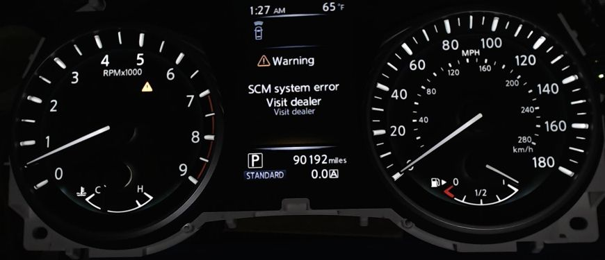
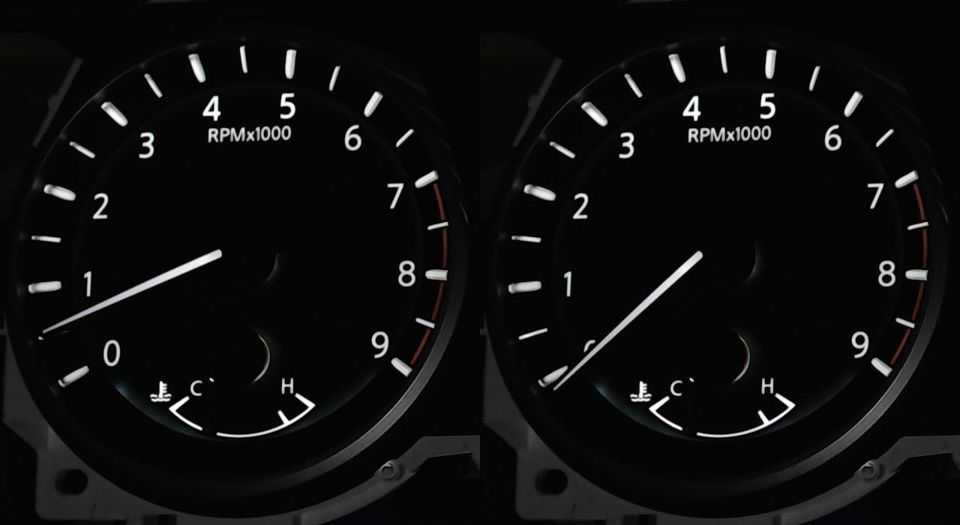

# Main-bus sweep of undecoded IDs (bench, 2026-10-12)

Camera-checked sweep of the 29 background IDs that `q50tb/signals/q50_main.py` did not decode.
Bench mode on the real meter (B+ and IG on, idle baseline profile, speed 0, AV head-unit emulation running).
Results are what the camera showed; nothing here is an OEM specification.

## Findings

| ID | Bits | Meter effect | Recorded as |
|---|---|---|---|
| 0x02A | B4 bit 0 | **"⚠ Warning / SCM system error / Visit dealer"** on the centre display + amber master-warning triangle on the tach. Clears when the bit clears. Bits 1-7 of B4 do nothing. | `main.02A.SCM_SYSTEM_ERROR`, confirmed |
| 0x6E2 | B6 bit 6 | Tach needle drops from ~700 rpm idle to **0** and returns when cleared (5 of 5 repeats). No telltale or message. Other bits of B6 do nothing. Meaning unknown. | `main.6E2.TACH_ZERO_FLAG`, probable |

Also from this session (separate test): 0x54C B6 is the outside temperature, raw = (°C + 41) × 2, 0xFF = "---"
(`main.54C.OUTSIDE_TEMP`, confirmed).

## Method

1. **Timeout:** each ID was stopped for 10 s (background message disabled), then re-enabled.
2. **Bytes:** each byte, one at a time, was overridden to `FF`, then to `00` (skipped where the baseline already
   had that value), held 1.5 s, then the override was removed. Counters/checksums kept running.
3. **Bits:** the two bytes that changed something were walked bit by bit (and repeated) to find the bit.

After every step a camera frame was compared with the frame just before it, limited to the gauge faces and the
centre display, ignoring the clock/outside-temperature line, and counting only pixels that are bright in one of the
frames (so bezel exposure drift does not count). A known warning (0x56C B0 bit 1, Chassis Control System Error)
was used as a positive control: it was detected, and it scored 0 after clearing.
Every flagged frame was then checked by eye.

## IDs with no visible effect

Stopping the message for 10 s and setting any single byte to `FF` or `00` changed nothing on the meter for:

| ID | Baseline payload | Period ms |
|---|---|---|
| 0x174 | `FF E7 1C AA 0D 10 00 00` | 10 |
| 0x177 | `FE 10 00 00 00 F8 00 00` | 10 |
| 0x1C3 | `00 00 00 00 64 01 FF 28` | 10 |
| 0x215 | `FF FC FF 00 FF FF` | 20 |
| 0x245 | `FF E0 00 18 A8 00 FF E0` | 20 |
| 0x286 | `00 00` | 20 |
| 0x2AA | `00 03 83 E8 00 00 08 22` | 20 |
| 0x2B0 | `00 0F FF 8C 1B 00 2E 00` | 10 |
| 0x3DB | `00 27 B5 9E 7D 4B 1D 1F` (rolling) | 100 |
| 0x3DC | `00 24 3C F6 DE C6 80 C9` (rolling) | 100 |
| 0x4CB | `01 20 00 00 00 00` | 100 |
| 0x4DF | `00 00 00 04` | 100 |
| 0x540 | `00 24 00 00 00 00 00 00` | 100 |
| 0x541 | `00 00 00 00 00 00 00 83` | 100 |
| 0x542 | `00 00 00 00 00 00 00 03` | 100 |
| 0x544 | `00 00 00 00` | 100 |
| 0x545 | `00 00 00 00 00 00 00 03` | 100 |
| 0x54E | `00 00 00 00 00 C0 00 00` | 100 |
| 0x560 | `80 11 48 00` | 100 |
| 0x5B0 | `04 80` | 100 |
| 0x5B4 | `FF FF FF FF FF FF FF 00` | 500 |
| 0x5B5 | `FF FF FF FF FF FF FF 00` | 500 |
| 0x5B6 | `FF FF FF FF FF FF FF 00` | 500 |
| 0x5B7 | `FC FC FC C7 CD FF 1F F8` | 500 |
| 0x5E8 | `00 00 00 00 00` | 500 |
| 0x5FE | `80 00 FF FF 00 00 00` | 500 |
| 0x6C0 | `00` | 500 |

0x02A and 0x6E2 showed nothing when stopped and nothing for the other bytes.

## Limits (what this sweep can miss)

* Only `FF` and `00` per byte. A multi-bit field where both are "invalid/none" (common for enums) can hide values
  in between; individual bits were walked only for the two bytes that reacted.
* One byte at a time: effects that need two fields together (or a defined signal in another message, e.g. RPM > 0,
  speed > 0, a particular gear or page) were not tried. Speed was kept at 0.
* Timeouts longer than 10 s, and anything that only shows after a meter reboot, were not tested.
* Only what the camera sees: chimes, backlight dimming below the threshold, and items on centre-display pages
  other than the one shown (Range) would be missed.
* No output was read from the meter's own messages (0x280, 0x2DE, 0x355, 0x5C5) during the sweep.
